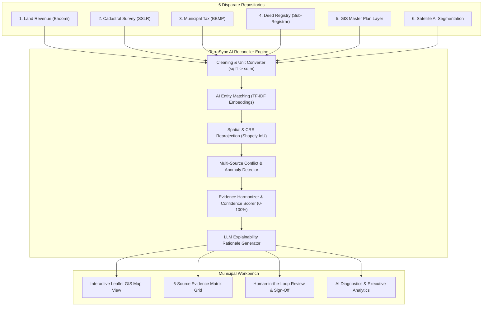

# TerraSync AI - Multi-Source Urban Land Data Harmonization & Conflict Detection Platform

[](LICENSE)
[](https://fastapi.tiangolo.com/)
[](https://react.dev/)
[](https://tailwindcss.com/)
[](https://shapely.readthedocs.io/)

> **TerraSync AI** is an advanced, AI-powered GIS platform that turns fragmented and inconsistent urban land data into one unified, verifiable, and evidence-backed property record. It automates the entire ingestion, cleaning, entity matching, spatial alignment, and conflict-detection pipeline, allowing municipal and government officials to verify land records transparently.

---

## 🎯 The Core Problem

Urban land information is heavily scattered across six disparate sources:
1. **Land Revenue Records** (Bhoomi DB)
2. **Cadastral Map Surveys** (SSLR Vector Maps)
3. **Municipal Property Tax Databases** (BBMP PIDs)
4. **Registration Records** (Sub-Registrar Deeds / OCR PDFs)
5. **GIS Datasets** (Urban Master Plan Shapefiles)
6. **Satellite Imagery** (Planet / Sentinel AI Footprints)

These sources operate in silos with different formats, property IDs, boundaries, area values, and coordinate reference systems (CRS). They frequently produce conflicting data, duplicate entries, and misaligned spatial overlaps.

---

## 💡 Key Differentiators & Innovation

- 🤖 **AI Property Entity Matching**: Links corresponding records across disparate repositories using TF-IDF sentence vector embeddings and fuzzy string matching.
- 📐 **Spatial Intelligence & CRS Alignment**: Normalizes spatial references ($\text{EPSG:4326} / \text{EPSG:3857}$) and evaluates polygon topology, Intersection over Union (IoU), and centroid offsets using Shapely.
- ⚠️ **Automated Conflict Detection**: Identifies area extent discrepancies ($>4\%$), owner name spelling mismatches, physical satellite encroachments, and land-use zoning conflicts.
- 📜 **Evidence-Based Lineage Provenance**: Compiles single source of truth recommendations while preserving original silo values.
- 🧠 **Explainable AI (LLM Rationale)**: Generates transparent, non-blackbox executive summaries detailing exact causes of property mismatches and recommended action items.
- 👤 **Human-in-the-Loop Verification Workbench**: Retains final human authority allowing municipal officials to review AI suggestions, override fields, and commit records to the master PostGIS ledger.

---

## 🏗️ System Architecture



---

## 🛠️ Detailed Tech Stack

- **Frontend**: React 18, TypeScript, Vite, Tailwind CSS v4, Lucide React Icons, Leaflet GIS (`leaflet`).
- **Backend**: Python 3.11, FastAPI, Uvicorn, Pydantic v2.
- **AI / ML Layer**: Scikit-Learn (TF-IDF vectorizers, cosine similarity), Sentence Transformers, Regex text cleaning, PyPDF2/OCR extractors.
- **Geospatial Processing**: GeoPandas, Shapely (polygon topology, IoU, area ratio variance), PyProj (CRS transformations).
- **Database / Ledger**: PostGIS / SQLite in-memory GIS persistence.

---

## 🚀 Getting Started

### Prerequisites
- Python 3.10+
- Node.js v18+ and npm

### 1. Clone & Setup Backend
```bash
git clone https://github.com/SanjanaTech19/TerraSyncAI.git
cd TerraSyncAI/backend

# Run FastAPI Server
python main.py
```
*Backend runs locally at `http://127.0.0.1:8000` (API Docs at `http://127.0.0.1:8000/docs`)*

### 2. Setup & Run Frontend
```bash
cd ../frontend

# Install dependencies & start Vite dev server
npm install
npm run dev -- --host 127.0.0.1 --port 5173
```
*Frontend runs locally at `http://127.0.0.1:5173`*

---

## 📄 License
Licensed under the [MIT License](LICENSE).
